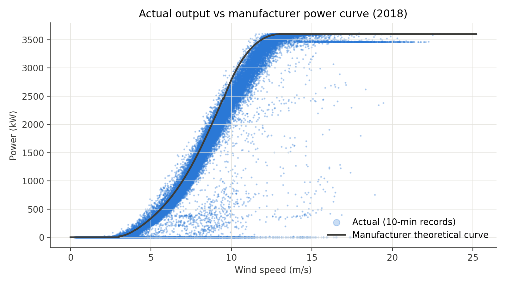
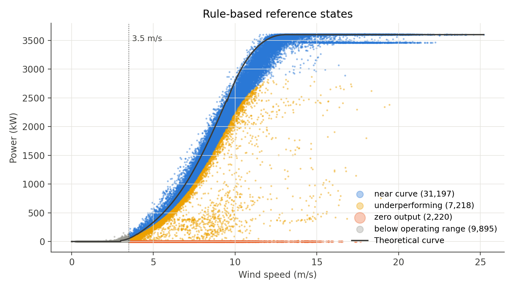

# Data-Driven Wind Turbine Performance Monitoring to Reduce Clean Energy Losses (SDG 7)

** Machine Learning **

A machine learning pipeline that uses wind turbine SCADA data to separate abnormal operating states from normal behaviour, learn the turbine's realistic "healthy" power curve, and estimate how much clean energy (and CO₂) is lost so that maintenance can be prioritised.



---

## Problem

Wind turbines are expected to follow the manufacturer's theoretical power curve, but in practice they often produce less because of faults, curtailment, shutdowns and gradual decline. SCADA records mix all of these with normal operation and carry **no fault labels**, so operators cannot easily tell which losses are recoverable.

For the turbine in this dataset (2018):

| Measure | Value |
|---|---|
| Actual energy generated | ~11,013 MWh |
| Expected from manufacturer curve | ~12,567 MWh |
| Shortfall (sum of below-curve intervals) | ~1,600 MWh (12.7 %) |
| Zero/negative output with wind ≥ 3.5 m/s | 2,220 intervals (~370 h, ~456 MWh) |
| Equivalent CO₂ (0.740 tCO₂/MWh, Peninsular Malaysia grid) | ~1,180 t |

## Approach

1. **Clustering (unsupervised):** K-Means and DBSCAN group the 10-minute records into suspected operating states (normal, shutdown-like, curtailment-like, underperforming).
2. **Regression (supervised):** Random Forest and XGBoost learn the healthy power curve from normal-state records only, validated with month-blocked cross-validation (MAE, RMSE, R²).
3. **Loss quantification:** `max(expected − actual, 0) × 1/6 h` per record, reported in MWh and tonnes of CO₂ by state, month, wind speed bin and direction sector, using both the manufacturer and ML baselines.

States are inferred from data alone, so they are reported as **suspected states, not confirmed faults**.

## Dataset

- **Source:** [Wind Turbine SCADA Dataset — Berk Erisen, Kaggle](https://www.kaggle.com/datasets/berkerisen/wind-turbine-scada-dataset)
- **Coverage:** 1 Jan – 31 Dec 2018, one 3.6 MW turbine in Turkey
- **Size:** 50,530 ten-minute records, 5 columns

| Column | Meaning |
|---|---|
| `Date/Time` | Timestamp (DD MM YYYY HH:MM) |
| `LV ActivePower (kW)` | Actual power output — regression target |
| `Wind Speed (m/s)` | Hub wind speed |
| `Theoretical_Power_Curve (KWh)` | Manufacturer expected output (treated as kW; max = 3,600 = rated power) |
| `Wind Direction (°)` | Direction the wind blows from |

## Repository structure

```
wind_turbine/
├── windturbine.ipynb          # Data understanding, preprocessing, feature engineering
├── wind_turbine.csv           # Raw SCADA data (Kaggle)
├── out/
│   ├── wind_features.csv          # Full cleaned table with all engineered features
│   ├── cluster_input_scaled.csv   # Scaled clustering input (operating region only)
│   ├── cluster_scaler.joblib      # StandardScaler + feature list for the clustering input
│   ├── data_quality_summary.csv   # Data quality checks and actions
│   └── feature_dictionary.csv     # Every feature with its reason and role
└── figures/
    ├── 01_power_curve_raw.png
    ├── 02_coverage_by_month.png
    ├── 03_wind_rose.png
    └── 04_rule_states.png
```

## Getting started

```bash
pip install numpy pandas matplotlib scikit-learn joblib xgboost
jupyter notebook windturbine.ipynb
```

Run all cells. The notebook reads `wind_turbine.csv` from the same folder (change `DATA_PATH` in the first cell if needed) and writes everything to `out/` and `figures/`.

## Preprocessing summary

| Check | Result | Action |
|---|---|---|
| Unparseable timestamps | 0 | — |
| Null values | 0 | No imputation needed |
| Duplicate rows / timestamps | 0 / 0 | — |
| Missing 10-minute slots | 2,030 (3.9 %) | **Not imputed**; flagged via `gap_before_min` |
| Largest gap | 625 slots (~4.3 days, Jan) | Reported as a limitation |
| Physically impossible values | 0 | Range rules on speed, direction and power |
| Negative power records | 57 (min −2.47 kW) | **Kept** — idle/shutdown signal |

Key decisions:
- Only impossible values are removed. Zero output, curtailment plateaus and underperformance are what the project is trying to detect, so they stay.
- Cut-in speed is read from the manufacturer curve (3.0 m/s); the operating region is **≥ 3.5 m/s** (cut-in + 0.5 m/s buffer).
- Theoretical power is used only as a reference and for feature engineering, **never as a regression input**.
- Time features (`month`, `hour`) are for reporting and CV grouping only, to avoid leakage.

## Engineered features

| Feature | Role |
|---|---|
| `power_ratio` (actual ÷ theoretical, operating region only) | Clustering input |
| `residual_kw` (theoretical − actual) | Clustering input |
| `wd_sin`, `wd_cos` (circular wind direction) | Regression input; optional clustering input |
| `ws_bin` (0.5 m/s), `dir_sector` (30°) | Reporting |
| `actual_kwh`, `theo_kwh`, `shortfall_kwh` | Loss quantification |
| `in_operating_region`, `rule_state` | Subset selection and physical rule check (not a label) |

Full details are in [`out/feature_dictionary.csv`](out/feature_dictionary.csv).

### Rule-based reference states

A simple physical-rule reference used to sanity-check clusters (not used as labels):

| rule_state | Records | Shortfall (MWh) | Share of shortfall |
|---|---:|---:|---:|
| near_curve | 31,197 | 700.2 | 43.8 % |
| zero_output | 2,220 | 456.1 | 28.5 % |
| underperforming | 7,218 | 436.0 | 27.3 % |
| below_operating_range | 9,895 | 7.6 | 0.5 % |



`near_curve` still holds a large share of the loss because it includes the curtailment-like plateau at ~3,450 kW above rated wind speed. Separating that is the job of clustering.

## Project status

- [x] Data understanding
- [x] Data preprocessing
- [x] Feature engineering and model-ready outputs
- [ ] Clustering (K-Means, DBSCAN)
- [ ] Healthy power curve regression (Random Forest, XGBoost)
- [ ] Energy loss and CO₂ quantification
- [ ] Maintenance priority (Pareto) and report

## Team

| Member | Responsibility |
|---|---|
| Mohammad Fakhri Hakimi bin Azami | Data acquisition and understanding |
| Nik Muhammad Afiq Aiman bin Mohd Ariff | Data preprocessing, feature engineering |
| Muhammad Umair Arif bin Mohd Azmi | Model development, evaluation and comparison |
| Muhammad Safuan bin Rosmi | Data preprocessing, interpretation and sustainability analysis |
| Mohamad Ashraf Jaffery bin Mohamad Noornasrul Jaffery | Report and presentation |

## References

1. B. Erisen, "Wind Turbine Scada Dataset," Kaggle. https://www.kaggle.com/datasets/berkerisen/wind-turbine-scada-dataset
2. Energy Commission Malaysia, "Grid Emission Factor (GEF) in Malaysia 2022–2024 (provisional)." https://myenergystats.st.gov.my
3. F. Bilendo et al., "Applications and Modeling Techniques of Wind Turbine Power Curve for Wind Farms — a Review," *Energies*, 16(1), 180, 2023.
4. R. Morrison, X. Liu and Z. Lin, "Anomaly Detection in Wind Turbine SCADA Data for Power Curve Cleaning," *Renewable Energy*, 184, 473–486, 2022.
5. C. Bergmeir and J. M. Benítez, "On the Use of Cross-Validation for Time Series Predictor Evaluation," *Information Sciences*, 191, 192–213, 2012.
